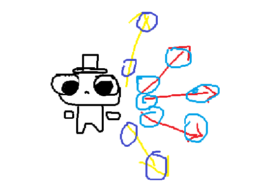
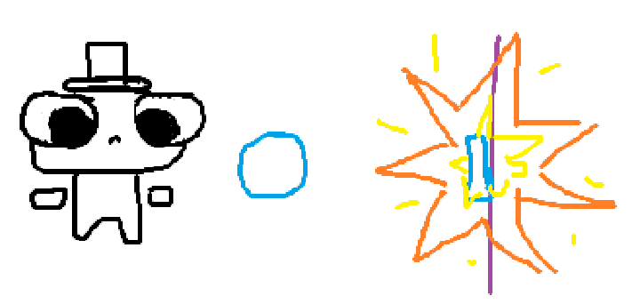
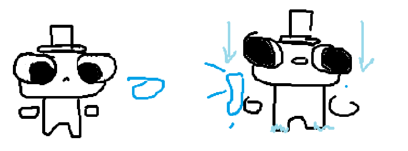

## Spreadshot
Cada vez que disparas se disparan **3 hechizos. (+2)**\
Al conseguir **otra copia** - a se volverán **5 hechizos (+2 y sucesivamente)**\

## Exploding Rounds
Explotan al entrar en contacto con una **superficie o un jugador**\
La explosion es aproximandamente del **tamaño de un jugador**\
Al conseguir **otra copia** - la explosión **aumentara de tamaño (x2)**\

## Ice Rounds
Al chocar con un jugador, la velocidad del jugador es reducida por **50% por 2 segundos**\
Al conseguir **otra copia** - se reduce la velocidad por **4 segundos (+2 por copia)**\

